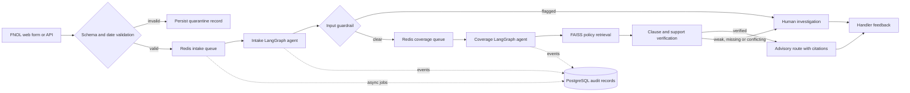

# ClaimFlow — motor claim intake and triage

ClaimFlow is an end-to-end MLOps mini-project for asynchronous First Notice of Loss intake and evidence-backed claim triage. It accepts structured motor-claim details, uses two separately queued agents to classify/extract and investigate policy evidence, then recommends a handler route with citations. Recommendations are advisory; the system never approves, rejects, settles, or calculates a claim.

## Start the project

Prerequisites: Docker Desktop with Compose v2, 8 GB or more memory recommended, and network access for initial container images. Runtime source downloads are attempted when enabled; offline excerpt files are provided as a fallback.

```powershell
docker compose up --build -d
docker compose ps
docker compose logs -f corpus-indexer api intake-worker coverage-worker
```

Open [the ClaimFlow workspace](http://localhost:8080). The initial corpus index build can take a few minutes. Check `http://localhost:8000/health/ready` or `/health/ready` through the workspace host before submitting claims.

| Local page | Purpose |
|---|---|
| `http://localhost:8080` | Lilcloud-inspired claims dashboard, intake, policy evidence, evaluations and handler feedback |
| `http://localhost:8000/docs` | Interactive FastAPI API documentation |
| `http://localhost:3000` | Grafana dashboards (local anonymous access) |
| `http://localhost:9090` | Prometheus metrics and queries |
| `http://localhost:16686` | Jaeger traces |
| `http://localhost:8089` | Optional Locust control page |

All published ports bind to loopback. Use synthetic information only: this educational workspace has no user authentication or authorization and is not ready for real claim or personal data.

## Claim lifecycle



FastAPI writes the validated FNOL and queues an intake job. The dedicated intake worker extracts a bounded set of fields and hands the run to a separate coverage queue. The coverage agent searches for an apparent grant and then separately searches for restrictions, exceptions, or other modifying terms. Search, clause lookup, and FNOL-field lookup are bounded tools. Every final citation must resolve to a retrieved passage and the summary must pass a lightweight lexical-support check. Verification failures and model/provider outages route to a human-review result.

PostgreSQL stores FNOL records, run state, correlation IDs, agent events, prompt versions, token/cost estimates, quarantine records, handler feedback, and sampled quality indicators. Redis backs RQ job queues, idempotency/rate-limit state, retrieval cache, and circuit-breaker state. Local sparse word/bigram hashing plus FAISS makes indexing repeatable without a hosted embeddings key. OpenTelemetry spans export to Jaeger; Prometheus scrapes API, agent, and cAdvisor metrics; Grafana is provisioned with an agent/service health dashboard.

## Demonstration

1. Submit a synthetic claim in the form or `POST /api/v1/runs`.
2. Poll the returned `run_id` at `GET /api/v1/runs/{run_id}`. The workspace refreshes in the background and opens its evidence drawer after a new submission.
3. Open the run to view extraction, classification, route, clause citations, verification, prompt version, usage and timeline.
4. Add a handler rating and reason from a terminal run. Feedback is recorded for inspection at `/api/v1/feedback/summary` and `/api/v1/feedback/recent`.
5. Use the **Use delivery scenario** button to try the intentionally difficult paid food-delivery case. The index includes both the own-damage wording and private-car use restrictions; the expected behavior is an investigation route for handler review.
6. Use **Simulate outage** to exercise bounded provider retries and safe human fallback. It enables a local Redis flag for 60 seconds and does not make an external provider call.

The UI uses a near-black background, compact mono labels, restrained borders and rounded panels inspired by the requested Lilcloud project. It is an original ClaimFlow workspace, not a copy of Lilcloud's application.

## API surface

| Route | Purpose |
|---|---|
| `POST /api/v1/runs` | Validate, quarantine or asynchronously accept an FNOL (202) |
| `GET /api/v1/runs?limit=50` | List recent runs |
| `GET /api/v1/runs/{run_id}` | Read run state, result, clauses and event timeline |
| `GET /api/v1/quarantine` | Review invalid submissions; no agent starts for quarantined input |
| `POST /api/v1/runs/{run_id}/feedback` | Record handler satisfaction and a reason |
| `GET /api/v1/feedback/summary`, `/recent` | Inspect the feedback loop |
| `GET /api/v1/dashboard` | Run totals, latency, SLO, route, worker, cost, feedback and quality snapshot |
| `GET /api/v1/quality/trend` | Sampled live groundedness, context relevance, faithfulness and hallucination indicator |
| `GET /api/v1/corpus/status`, `/sources` | Inspect index build and source manifest |
| `GET /api/v1/evaluation/summary` | Show the 20-case benchmark definition and latest recorded run |
| `POST /api/v1/demo/provider-outage` | Enable or clear the local fallback demonstration |
| `GET /metrics`, `/health/live`, `/health/ready` | Prometheus and service health |

The API validates registration numbers and cross-field date/injury consistency, limits request size through field bounds, rejects unknown JSON keys, supports `Idempotency-Key` (with client reference fallback), adds correlation IDs, and applies a configurable per-client submission limit. Invalid Pydantic input is redacted and stored in quarantine with `agent_run_started: false`.

## Evaluation

The labeled set in `evaluation/cases.json` has 20 synthetic scenarios, including private and professional use, theft/police reporting, third-party injury, possible total loss, high repair estimate, paid delivery and commercial use restrictions, unsupported insurer/product scope, and a prompt-injection attempt. It scores position, route, escalation, classification, guardrail, and citation integrity, and includes a malformed-payload quarantine check.

After starting the stack, run:

```powershell
python -m pip install httpx
python evaluation/evaluate.py --base-url http://localhost:8000
```

It writes a timestamped JSON result and CSV to `evaluation/results/`, plus `latest.json` for the dashboard. It waits between requests so the default rate limit remains active. The suite is a small regression aid; it does not establish policy correctness or real-world performance. Do not interpret a score as a claim decision.

### Locust workload

Open the optional interactive page:

```powershell
docker compose --profile loadtest up -d locust
```

For a repeatable headless run with eight users, a one-user-per-second spawn, and two minutes of traffic:

```powershell
docker compose --profile loadtest run --rm locust locust -f app/loadtest/locustfile.py --host http://api:8000 --headless --users 8 --spawn-rate 1 --run-time 2m --csv /app/evaluation/results/loadtest
```

The workload submits varied synthetic claims and polls each asynchronous result. For higher load, set `CLIENT_RATE_LIMIT_PER_MINUTE=600` in a local, untracked `.env` before recreating the API service; restore the normal rate limit afterward. Record worker count, machine, provider, corpus fingerprint, rate limit, run duration and Locust output with any reported capacity result. No performance result is checked in without being measured.

## Configuration and maintenance

`.env.example` documents supported settings. Copy it to `.env` only when a local override is needed. The default is a deterministic stub and zero model cost; real external-provider calls require an OpenAI-compatible chat completions endpoint, model identifier, optional bearer key and configured token prices. Keep the secret in `.env` and out of version control.

For a local reproducible reset that preserves data, use `docker compose down` followed by `docker compose up --build -d`. PostgreSQL, Redis, FAISS index, source PDFs, Prometheus and Grafana each use named volumes. To rebuild embeddings after a source/corpus edit, run `docker compose run --rm -e FORCE_REEMBED=1 corpus-indexer`, then restart API and workers. Avoid `docker compose down -v` unless you intend to erase database and telemetry volumes.

See [the runbook](docs/RUNBOOK.md), [project report](docs/REPORT.md), [evaluation notes](evaluation/README.md), [incident worksheet](docs/INCIDENT_LOG.md), and [corpus notes](corpus/README.md).

## Policy sources

The current corpus references official documents hosted by New India Assurance: [Private Car Base Package Policy](https://www.newindia.co.in/assets/docs/know-more/motor/STANDARD%20FORM%20FOR%20PRIVATE%20CAR%20BASE%20PACKAGE%20POLICY.pdf), [India Motor Tariff 2002](https://www.newindia.co.in/cms/2a38793a-2c85-4d42-bc23-d510918c432e/IMT%202002.pdf?guest=true), and [Motor Insurance Do's and Don'ts](https://www.newindia.co.in/assets/docs/know-more/motor/DOs%20AND%20DONTS%20Motor_dep.pdf). Review current wording, schedule, endorsements, and claim circumstances with the insurer before real-world use.
