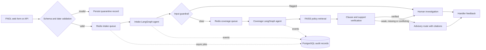

# ClaimFlow — motor claim intake and triage

ClaimFlow is an end-to-end MLOps mini-project for asynchronous First Notice of Loss intake and evidence-backed claim triage. It accepts structured motor-claim details, uses two separately queued agents to classify/extract and investigate policy evidence, then recommends a handler route with citations. Recommendations are advisory; the system never approves, rejects, settles, or calculates a claim.

## Project Overview

ClaimFlow is an asynchronous, human-reviewed motor claim intake and triage demonstration. It accepts a First Notice of Loss (FNOL), validates and quarantines malformed input, extracts incident fields with an intake agent, retrieves relevant policy passages with a separate coverage agent, verifies citations, and routes the result for fast-track handling, surveyor assignment, or investigation. The service records prompt versions, model usage, latency, retries, quality samples, feedback, queue health, metrics, and traces. It makes advisory recommendations only; a claims handler remains responsible for decisions.

## Start the project

Prerequisites: Docker Desktop with Compose v2, 8 GB or more memory recommended, and network access for initial container images. Runtime source downloads are attempted when enabled; offline excerpt files are provided as a fallback.

### Local setup steps

1. **Clone the repository** and ensure Docker Desktop is running with Compose v2.
2. **Start the stack**:
   ```powershell
   docker compose up --build -d
   ```
3. **Verify the indexer completed**: wait for the corpus-indexer container to finish building the FAISS index (check `docker compose ps`).
4. **Check readiness**: verify `http://localhost:8000/health/ready` returns healthy before submitting claims.
5. **Open the workspace**: navigate to `http://localhost:8080` to use the claims dashboard.

### Post-start configuration

- **Local overrides**: copy `.env.example` to `.env` only when a local override is needed. The deterministic stub is the clean-start and load-testing default.
- **Real inference**: set `LLM_BACKEND=openai_compatible` and configure the provider's chat-completions base URL, model ID and API key in the ignored local `.env`.
- **Per-agent models**: `LLM_INTAKE_MODEL_ID` and `LLM_COVERAGE_MODEL_ID` can override the shared `LLM_MODEL_ID` independently.
- **Token pricing**: set token cost rates globally or per agent; use zero for a free tier.
- **Rate limits**: the default per-client submission limit can be overridden with `CLIENT_RATE_LIMIT_PER_MINUTE` in a local, untracked `.env`.
- **Locust load testing**: optionally start with `docker compose --profile loadtest up -d locust`.

### Reset and reproducibility

- **Preserve data**: use `docker compose down` followed by `docker compose up --build -d`. PostgreSQL, Redis, FAISS index, source PDFs, Prometheus and Grafana each use named volumes.
- **Rebuild embeddings**: after a source or prompt-independent wording change, run `docker compose run --rm -e FORCE_REEMBED=1 corpus-indexer`, then restart API and workers.
- **Erase all data**: use `docker compose down -v` only when intending to erase database and telemetry volumes.

Open [the ClaimFlow workspace](http://localhost:8080). The initial corpus index build can take a few minutes. Check `http://localhost:8000/health/ready` or `/health/ready` through the workspace host before submitting claims.

| Local page | Purpose |
|---|---|
| `http://localhost:8080` | Lilcloud-inspired claims dashboard, intake, policy evidence, evaluations and handler feedback |
| `http://localhost:8000/docs` | Interactive FastAPI API documentation |
| `http://localhost:3000` | Grafana dashboards (local anonymous access) |
| `http://localhost:9090` | Prometheus metrics and queries |
| `http://localhost:16686` | Jaeger traces |
| `http://localhost:8089` | Optional Locust control page |

All published ports bind to loopback. Use synthetic information only: this educational workspace has no user authentication or authorization and is not ready for real claim or personal data.

## Claim lifecycle

The claim intake and triage workflow processes First Notice of Loss (FNOL) submissions through a structured asynchronous pipeline:

1. **Submission validation** - POST `/api/v1/runs` validates the FNOL schema, Indian registration format, date/injury consistency, loss type, and vehicle-use type. Invalid inputs are quarantined and no agent starts.
2. **Intake agent** - The Intake LangGraph agent (`I`) extracts bounded fields from the free-text description, screens for instruction injection/toxicity, and classifies the report. A safe handoff is queued to the coverage queue.
3. **Input guardrail** - Guardrail `G` flags potentially problematic inputs for human investigation (`H`) or clears them for coverage analysis.
4. **Coverage agent** - The Coverage LangGraph agent (`P`) searches the policy corpus via FAISS retrieval (`D`), identifies apparent grants and separately searches for restrictions, exceptions, or modifying terms. Citation IDs must resolve to retrieved passages.
5. **Lexical support check** - The summary must pass a lightweight lexical-support check; if it fails, the run routes to human investigation.
6. **Advisory routing** - Verified results receive an advisory route with citations (`T`). Unverified or conflicting results route to human investigation (`H`).
7. **Handler feedback** - The route reason and handler rating are recorded via `POST /api/v1/runs/{run_id}/feedback`.



FastAPI writes the validated FNOL and queues an intake job. The dedicated intake worker extracts a bounded set of fields and hands the run to a separate coverage queue. The coverage agent searches for an apparent grant and then separately searches for restrictions, exceptions, or other modifying terms. Search, clause lookup, and FNOL-field lookup are bounded tools. Every final citation must resolve to a retrieved passage and the summary must pass a lightweight lexical-support check. Verification failures and model/provider outages route to a human-review result.

## Agent responsibilities

**Intake Agent** (`I`): The Intake LangGraph agent extracts bounded fields from the free-text FNOL description, screens for instruction injection and toxicity, classifies the report, and queues a safe handoff to the coverage queue. It operates on the Redis intake queue and its events are recorded in PostgreSQL.

**Coverage Agent** (`P`): The Coverage LangGraph agent searches the policy corpus via FAISS retrieval, identifies apparent grants and separately searches for restrictions, exceptions, or other modifying terms. It performs clause and support verification, ensures citation IDs resolve to retrieved passages, and validates lexical support for summaries. Coverage analysis has bounded steps, tool calls, wall time, and tool timeouts. Events are recorded in PostgreSQL and backed by Redis queue state.

## RAG and policy retrieval process

ClaimFlow uses a Retrieval-Augmented Generation (RAG) approach for policy verification:

1. **Corpus indexing** - The policy documents (Private Car Base Package Policy, India Motor Tariff 2002 private-car section, and Motor Insurance Do's and Don'ts) are indexed using sparse word/bigram hashing and FAISS vector similarity. The index manifest distinguishes `official_pdf` from `offline_excerpt` sources.
2. **Query embedding** - The coverage agent converts the FNOL description and extracted fields into a query vector.
3. **Passage retrieval** - FAISS retrieves the most similar policy passages based on vector similarity, with a fallback to offline excerpt content when remote PDF downloads are unavailable.
4. **Grant and restriction search** - The agent performs two separate searches: one for apparent grant clauses and another for restrictions, exceptions, or modifying terms that may limit coverage.
5. **Citation validation** - Every citation in the summary must resolve to a retrieved passage. A lightweight lexical-support check verifies that cited passages actually support the summary claims.
6. **Verification routing** - If retrieval is weak, missing, or conflicting, or if the lexical check fails, the run is routed to human investigation instead of an advisory route.

PostgreSQL stores FNOL records, run state, correlation IDs, agent events, prompt versions, token/cost estimates, quarantine records, handler feedback, and sampled quality indicators. Redis backs RQ job queues, idempotency/rate-limit state, retrieval cache, and circuit-breaker state. Local sparse word/bigram hashing plus FAISS makes indexing repeatable without a hosted embeddings key. OpenTelemetry spans export to Jaeger; Prometheus scrapes API, agent, and cAdvisor metrics; Grafana is provisioned with an agent/service health dashboard.

## Demonstration

1. Submit a synthetic claim in the form or `POST /api/v1/runs`.
2. Poll the returned `run_id` at `GET /api/v1/runs/{run_id}`. The workspace refreshes in the background and opens its evidence drawer after a new submission.
3. Open the run to view extraction, classification, route, clause citations, verification, prompt version, usage and timeline.
4. Add a handler rating and reason from a terminal run. Feedback is recorded for inspection at `/api/v1/feedback/summary` and `/api/v1/feedback/recent`.
5. Use the **Use delivery scenario** button to try the intentionally difficult paid food-delivery case. The index includes both the own-damage wording and private-car use restrictions; the expected behavior is an investigation route for handler review.
6. Use **Simulate outage** to exercise bounded provider retries and safe human fallback. It enables a local Redis flag for 60 seconds and does not make an external provider call.

`Completed` records a verified automated review. A completed run can still be routed to investigation for a handler. Runs escalated after a coverage processing failure show **Retry coverage analysis**, which preserves the completed intake and queues coverage again.

The UI uses a near-black background, compact mono labels, restrained borders and rounded panels inspired by the requested Lilcloud project. It is an original ClaimFlow workspace, not a copy of Lilcloud's application.

## API surface

| Route | Purpose |
|---|---|
| `POST /api/v1/runs` | Validate, quarantine or asynchronously accept an FNOL (202) |
| `GET /api/v1/runs?limit=50` | List recent runs |
| `GET /api/v1/runs/count` | Return the total submitted-claim count for the live navigation badge |
| `GET /api/v1/runs/{run_id}` | Read run state, result, clauses and event timeline |
| `POST /api/v1/runs/{run_id}/retry` | Retry coverage after a recorded processing failure |
| `GET /api/v1/quarantine` | Review invalid submissions; no agent starts for quarantined input |
| `POST /api/v1/runs/{run_id}/feedback` | Record handler satisfaction and a reason |
| `GET /api/v1/feedback/summary`, `/recent` | Inspect the feedback loop |
| `GET /api/v1/dashboard` | Run totals, latency, SLO, route, worker, cost, feedback and quality snapshot |
| `GET /api/v1/quality/trend` | Sampled live groundedness, context relevance, faithfulness and hallucination indicator |
| `GET /api/v1/corpus/status`, `/sources` | Inspect index build and source manifest |
| `GET /api/v1/evaluation/summary` | Show the 20-case benchmark definition and latest recorded run |
| `POST /api/v1/demo/provider-outage` | Enable or clear the local fallback demonstration |
| `GET /metrics`, `/health/live`, `/health/ready` | Prometheus and service health |

The API validates registration numbers and cross-field date/injury consistency, limits request size through field bounds, rejects unknown JSON keys, supports `Idempotency-Key` (with client reference fallback), adds correlation IDs, and applies a configurable per-client submission limit. Invalid Pydantic input is redacted and stored in quarantine with `agent_run_started: false`.

## Evaluation

The labeled set in `evaluation/cases.json` has 20 synthetic scenarios, including private and professional use, theft/police reporting, third-party injury, possible total loss, high repair estimate, paid delivery and commercial use restrictions, unsupported insurer/product scope, and a prompt-injection attempt. It scores position, route, escalation, classification, guardrail, and citation integrity, and includes a malformed-payload quarantine check.

After starting the stack, run:

```powershell
python -m pip install httpx
python evaluation/evaluate.py --base-url http://localhost:8000
```

It writes a timestamped JSON result and CSV to `evaluation/results/`, plus `latest.json` for the dashboard. It waits between requests so the default rate limit remains active. The suite is a small regression aid; it does not establish policy correctness or real-world performance. Do not interpret a score as a claim decision.

### Locust workload

Open the optional interactive page:

```powershell
docker compose --profile loadtest up -d locust
```

For a repeatable headless run with eight users, a one-user-per-second spawn, and two minutes of traffic:

```powershell
docker compose --profile loadtest run --rm locust locust -f app/loadtest/locustfile.py --host http://api:8000 --headless --users 8 --spawn-rate 1 --run-time 2m --csv /app/evaluation/results/loadtest
```

The workload submits varied synthetic claims and polls each asynchronous result. For higher load, set `CLIENT_RATE_LIMIT_PER_MINUTE=600` in a local, untracked `.env` before recreating the API service; restore the normal rate limit afterward. Record worker count, machine, provider, corpus fingerprint, rate limit, run duration and Locust output with any reported capacity result. No performance result is checked in without being measured.

## Configuration and maintenance

`.env.example` documents supported settings. Copy it to `.env` only when a local override is needed. The deterministic stub remains the clean-start and load-testing default. To run real inference, set `LLM_BACKEND=openai_compatible` and configure the provider's chat-completions base URL, model ID and API key in the ignored local `.env`. `LLM_INTAKE_MODEL_ID` and `LLM_COVERAGE_MODEL_ID` can override the shared `LLM_MODEL_ID` independently; each call records its provider and model in the claim timeline. The default external request timeout is 20 seconds, with bounded exponential retries that honor numeric `Retry-After` headers. A manual coverage retry clears the provider circuit breaker before requeueing. Use `LLM_JSON_MODE=false` only if the selected endpoint does not accept the OpenAI JSON response-format option. Token cost rates can be set globally or per agent; use zero for a free tier. Never commit API keys. The free-tier and local provider choices change over time, so choose the model from its provider's current catalog.

For a local reproducible reset that preserves data, use `docker compose down` followed by `docker compose up --build -d`. PostgreSQL, Redis, FAISS index, source PDFs, Prometheus and Grafana each use named volumes. To rebuild embeddings after a source/corpus edit, run `docker compose run --rm -e FORCE_REEMBED=1 corpus-indexer`, then restart API and workers. Avoid `docker compose down -v` unless you intend to erase database and telemetry volumes.

See [the runbook](docs/RUNBOOK.md), [project report](docs/REPORT.md), [evaluation notes](evaluation/README.md), [incident worksheet](docs/INCIDENT_LOG.md), and [corpus notes](corpus/README.md).

## Policy sources

The current corpus references official documents hosted by New India Assurance: [Private Car Base Package Policy](https://www.newindia.co.in/assets/docs/know-more/motor/STANDARD%20FORM%20FOR%20PRIVATE%20CAR%20BASE%20PACKAGE%20POLICY.pdf), [India Motor Tariff 2002](https://www.newindia.co.in/cms/2a38793a-2c85-4d42-bc23-d510918c432e/IMT%202002.pdf?guest=true), and [Motor Insurance Do's and Don'ts](https://www.newindia.co.in/assets/docs/know-more/motor/DOs%20AND%20DONTS%20Motor_dep.pdf). Review current wording, schedule, endorsements, and claim circumstances with the insurer before real-world use.

## Monitoring and verification

ClaimFlow includes comprehensive monitoring, evaluation, and verification mechanisms:

### Tracing and spans
- OpenTelemetry spans are exported to Jaeger for end-to-end claim lifecycle visualization.
- Traces cover submission, validation, intake, coverage, retrieval, verification, and routing steps.
- Correlational IDs propagate through all agent events and database records.

### Metrics
- Prometheus scrapes API, agent, and cAdvisor metrics from the container stack.
- Key metrics include `claimflow_run_latency_seconds`, `claimflow_llm_retries_total`, queue depth, and worker uptime.
- Grafana dashboards provisioned with agent/service health measures for p50/p95 latency, token/cost estimates, and SLO tracking (target p95 ≤ 15 seconds).
- Circuit-breaker state for LLM provider retries is tracked via Redis and exposed as a metric.

### Evaluation
- The labeled set in `evaluation/cases.json` defines 20 synthetic scenarios covering private/professional use, theft, third-party injury, total loss, high repair estimates, commercial restrictions, and prompt-injection attempts.
- `python evaluation/evaluate.py --base-url http://localhost:8000` runs the benchmark and writes timestamped JSON/CSV results to `evaluation/results/`.
- Scores assess position, route, escalation, classification, guardrail, and citation-integrity agreement.
- A malformed-input quarantine check is included; the suite is a small regression aid and does not establish policy correctness.

### Verification mechanisms
- **Citation validation**: every summary citation must resolve to a retrieved passage via FAISS.
- **Lexical support check**: verifies cited passages actually support the summary claims.
- **Guardrail screening**: input guardrails flag instruction injection/toxicity before model execution.
- **Bounded tool calls**: coverage analysis has enforced step limits, tool call limits, wall time, and tool timeouts.
- **Provider circuit breaker**: Redis-backed state prevents repeated failed LLM calls;可通过 `POST /api/v1/demo/provider-outage` enabled/cleared for demonstration.
- **Handler feedback**: recorded via `POST /api/v1/runs/{run_id}/feedback` and inspectable at `/api/v1/feedback/summary` and `/recent`.

See [the runbook](docs/RUNBOOK.md), [project report](docs/REPORT.md), [evaluation notes](evaluation/README.md), [incident worksheet](docs/INCIDENT_LOG.md), and [corpus notes](corpus/README.md).

## Evaluation
- The labeled set in `evaluation/cases.json` has 20 synthetic scenarios, including private and professional use, theft/police reporting, third-party injury, possible total loss, high repair estimate, paid delivery and commercial use restrictions, unsupported insurer/product scope, and a prompt-injection attempt. It scores position, route, escalation, classification, guardrail, and citation integrity, and includes a malformed-payload quarantine check.

After starting the stack, run:

```powershell
python -m pip install httpx
python evaluation/evaluate.py --base-url http://localhost:8000
```

It writes a timestamped JSON result and CSV to `evaluation/results/`, plus `latest.json` for the dashboard. It waits between requests so the default rate limit remains active. The suite is a small regression aid; it does not establish policy correctness or real-world performance. Do not interpret a score as a claim decision.
